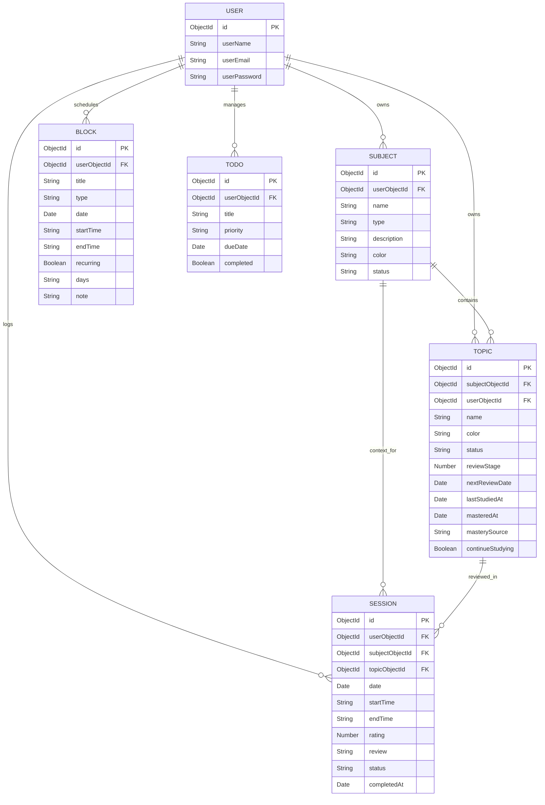
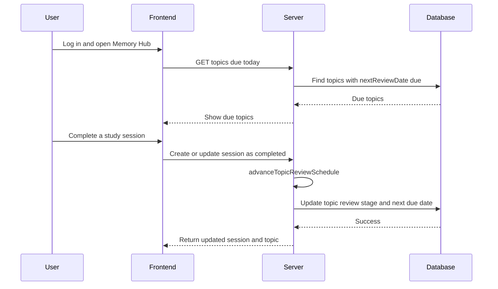

<div align="center">
  <h1>🌅 SunsetStudy</h1>
  <p><i>A beautifully crafted Study Management System designed around the Ebbinghaus Forgetting Curve. Study smarter, not longer! 🧠✨</i></p>

  
</div>

<br />

## Problem Description

Traditional study methods often lead to the **"Illusion of Competence"** students read material once, feel they know it, but experience rapid forgetting soon after. Without a systematic approach to reviewing materials, students struggle to manage their time effectively, lose track of what needs to be reviewed, and inevitably resort to stressful, low-retention cramming before exams.

## Proposed Solution

**SunsetStudy** organizes subjects, topics, study sessions, and calendar commitments around **spaced repetition**. Review gaps grow as you complete scheduled study, helping you build a repeatable learning habit. The forgetting curve illustrates memory decay; it is not a measured retention score.

---

## Features

See [Study workflow and new features](FEATURES.md) for JSON imports, to-dos, Pomodoro settings, and the mastery milestone.

- **Spaced reviews and mastery:** Complete initial study, then reviews after **1, 3, 7, 14, 30, and 60 days**. Early practice is logged without skipping review stages. After the final review, choose **Keep studying** for optional 60-day reviews or **Finish for now** to pause.
- **Memory Hub:** Explore each topic's illustrative forgetting curve, completion history, overdue reviews, and suggested dates. Plan a session directly from a review suggestion.
- **Subject library and JSON imports:** Organize **Academic**, **Hobby**, and **Project** subjects, add topics, archive subjects, and preview/import subjects with nested topics from JSON.
- **Calendar and study sessions:** Plan sessions alongside recurring or one-off commitments. Week/day views support overnight blocks. Log completion notes and ratings; removing an incorrect completion rebuilds its topic's schedule.
- **Persistent Pomodoro:** Focus and break timers survive navigation and browser refresh. Customize durations, rounds, and auto-start settings per account; use a session-linked or standalone timer.
- **To-do lists:** Add tasks with priorities and optional due dates, then edit, complete, reopen, or delete them.
- **Account protections:** JWT login, bcrypt password hashing, validated requests, account-scoped records, and safeguards against duplicate plans or deleting parents with related data.
- **Responsive sunset theme:** Light/dark layouts, pages loaded on demand, and shared API reads to reduce repeated loading.

### Coming soon

📱 **An Android app is coming soon**, bringing SunsetStudy to your phone. Stay tuned for release updates.

---

## Technologies Used

### Frontend
- **React 19** with **Vite** (fast development and builds)
- **Tailwind CSS v4** (utility-first styling via `@tailwindcss/vite`)
- **Framer Motion** (micro-interactions and animations)
- **React Router DOM v7** (client-side routing)
- **React Big Calendar** (schedule visualization)
- **Axios** (API communication)

### Backend
- **Node.js & Express.js** (REST API)
- **MongoDB & Mongoose** (document database)
- **JSON Web Tokens (JWT)** (stateless authentication)
- **Bcrypt.js** (password hashing)
- **Zod** (request validation)

---

## File & Folder Structure

```mermaid
graph TD
    Root["SunsetStudy (Root)"] --> Frontend["/frontend (React Client)"]
    Root --> Backend["/src (Express Server)"]
    Root --> RootFiles["Config & Tooling"]

    %% Frontend Structure
    Frontend --> F_Src["/src"]
    F_Src --> F_Components["/components"]
    F_Src --> F_Pages["/pages"]
    F_Src --> F_Utils["/utils & /constants"]
    F_Src --> F_App["App.jsx & main.jsx"]

    %% Backend Structure
    Backend --> B_Middlewares["/middlewares (auth)"]
    Backend --> B_Modules["/modules (domain logic)"]

    B_Modules --> Mod_Users["/users"]
    B_Modules --> Mod_Subjects["/subjects"]
    B_Modules --> Mod_Topics["/topics"]
    B_Modules --> Mod_Blocks["/blocks"]
    B_Modules --> Mod_Sessions["/sessions"]
    B_Modules --> Mod_Todos["/todos"]

    Backend --> B_App["app.js"]
    Backend --> B_DB["db.js"]

    RootFiles --> Pkg["package.json"]
    RootFiles --> Env[".env"]
    RootFiles --> Index["index.js (entry)"]
    RootFiles --> Seed["/seed & scripts/seed-demo.mjs"]
    RootFiles --> Shared["/shared (review policy)"]
    RootFiles --> Tests["/tests (web regressions)"]

    classDef folder fill:#ff9f43,stroke:#e67e22,stroke-width:2px,color:#fff;
    classDef file fill:#54a0ff,stroke:#2e86de,stroke-width:2px,color:#fff;

    class Frontend,Backend,F_Src,F_Components,F_Pages,F_Utils,B_Middlewares,B_Modules,Mod_Users,Mod_Subjects,Mod_Topics,Mod_Blocks,Mod_Sessions,Mod_Todos,Seed,Shared,Tests folder;
    class RootFiles,F_App,B_App,B_DB,Pkg,Env,Index file;
```



---

## Architecture Diagrams

### Entity-Relationship Diagram (Database)

Study **Blocks** (calendar commitments) and **Sessions** (topic study logs) are separate: sessions link to subjects and topics, not to blocks.



Enum values in the app: **Subject** `type` — `academic`, `hobby`, `project`; `status` | `active`, `archived`. **Topic** `status` — `not started`, `in progress`, `done`. **Block** `type` — `lecture`, `sleep`, `family`, `work`, `other`. **Session** `status` — `planned`, `completed`.

### Spaced Repetition Workflow

When a session is newly completed, the server rebuilds the topic review schedule from its completion history. Early practice cannot skip spaced intervals. The final scheduled review reaches mastery and pauses future suggestions until the user chooses to keep studying.

---

## API Endpoints

Protected routes (`/subjects`, `/topics`, `/blocks`, `/sessions`, `/todos`, and user management) require the header:

`Authorization: Bearer <your_jwt_token>`

### Users

Registration and login are public. Other user endpoints require JWT authentication and only access the current account.

| Method | Path | Description |
|--------|------|-------------|
| `POST` | `/users/register` | Register a new account |
| `POST` | `/users/login` | Authenticate and receive a JWT |
| `GET` | `/users` | List current account |
| `GET` | `/users/:id` | Get user by ID |
| `PATCH` | `/users/:id` | Update user |
| `DELETE` | `/users/:id` | Delete user |

**Register** body example:
```json
{
  "userName": "student01",
  "userEmail": "student@example.com",
  "userPassword": "SecurePass1!"
}
```

**Login** body example:
```json
{
  "userEmail": "student@example.com",
  "userPassword": "SecurePass1!"
}
```

### Subjects (auth required)
| Method | Path | Description |
|--------|------|-------------|
| `GET` | `/subjects` | List subjects for the user |
| `GET` | `/subjects/:id` | Get one subject |
| `POST` | `/subjects` | Create a subject |
| `POST` | `/subjects/import` | Previewed JSON batch import of subjects and nested topics |
| `PATCH` | `/subjects/:id` | Update a subject |
| `DELETE` | `/subjects/:id` | Delete a subject |

**Create subject** body example (`userObjectId` is set automatically from your JWT):
```json
{
  "name": "Data Structures",
  "type": "academic",
  "description": "CS201 Core Module",
  "color": "#FF5733"
}
```

### Topics (auth required)
| Method | Path | Description |
|--------|------|-------------|
| `GET` | `/topics/due-today` | Topics due for review today (spaced repetition) |
| `GET` | `/topics` | List topics |
| `GET` | `/topics/:id` | Get one topic |
| `POST` | `/topics` | Create a topic under a subject |
| `PATCH` | `/topics/:id` | Update a topic |
| `DELETE` | `/topics/:id` | Delete a topic |

### Blocks (auth required)
| Method | Path | Description |
|--------|------|-------------|
| `GET` | `/blocks` | List calendar blocks |
| `GET` | `/blocks/:id` | Get one block |
| `POST` | `/blocks` | Create a time block |
| `PATCH` | `/blocks/:id` | Update a block |
| `DELETE` | `/blocks/:id` | Delete a block |

### Sessions (auth required)
| Method | Path | Description |
|--------|------|-------------|
| `GET` | `/sessions` | List study sessions |
| `GET` | `/sessions/:id` | Get one session |
| `POST` | `/sessions` | Create a session; if `status` is `completed`, updates topic schedule |
| `PATCH` | `/sessions/:id` | Update a session; marking `completed` triggers spaced repetition |
| `DELETE` | `/sessions/:id` | Delete a session |

### To-do tasks (auth required)

| Method | Path | Description |
|--------|------|-------------|
| `GET` | `/todos` | List the current account's tasks |
| `POST` | `/todos` | Create a task |
| `PATCH` | `/todos/:id` | Edit, complete, or reopen a task |
| `DELETE` | `/todos/:id` | Delete a task |

Task fields: `title`, `priority` (`low`, `normal`, `high`), optional `dueDate`, and `completed`. Ownership is assigned from the JWT.

---

## Setup Instructions

Use **Node.js 24** for the development/test commands below, plus npm and MongoDB. The web checks have been validated with Node.js 24.

1. **Clone the repository**
   ```bash
   git clone https://github.com/Naveen-nm27/SunsetStudy.git
   ```

2. **Navigate to the project directory**
   ```bash
   cd SunsetStudy
   ```

3. **Install backend dependencies** (from the repo root)
   ```bash
   npm ci
   ```

4. **Install frontend dependencies**
   ```bash
   cd frontend
   npm ci
   cd ..
   ```

5. **Environment variables**

   Copy `.env.example` to `.env` in the **project root**, then configure:

   ```env
   PORT=3000
   MONGODB_URI=your_mongodb_connection_string
   JWT_SECRET=your_super_secret_jwt_key
   ```

   `MONGODB_URI` is required by `src/db.js` and the demo seed script.

6. **Optional: load demo data**
   ```bash
   npm run seed:demo
   ```

   Use a development database for demo seeding; the seed script replaces its demo records.

---

## How to Run the Project

Use two terminals—backend and frontend.

**Terminal 1 — Backend** (from the repo root):
```bash
npm start
```
Starts the API on `http://localhost:3000` (default `PORT` from `.env` or `3000`). Uses Node's built-in **watch mode** to reload on file changes.

**Terminal 2 — Frontend** (from `frontend/`):
```bash
npm run dev
```
Starts the Vite dev server (default `http://localhost:5173`). The client uses `VITE_API_URL`, defaulting to `http://localhost:3000` (see `frontend/src/api.js`).

### App routes (frontend)

| Path | Description |
|------|-------------|
| `/` | Landing page |
| `/login`, `/register` | Authentication |
| `/dashboard/memory` | Memory Hub (due topics) |
| `/dashboard/timeline` | Timeline / calendar |
| `/dashboard/library` | Subjects & topics library |
| `/dashboard/sessions` | Study sessions and Pomodoro |
| `/dashboard/todos` | To-do list |
| `/profile` | User profile (protected) |

---

## Run with Docker

Docker Compose starts MongoDB, the API, and the production frontend:

```bash
docker compose up --build
```

Open `http://localhost:8080` in a browser. The API is available at `http://localhost:3000`.

Before starting the stack, copy `.env.example` to `.env` and set a strong `JWT_SECRET`:

```bash
copy .env.example .env
```

The Compose setup supplies the internal MongoDB connection automatically. Data is stored in the `mongo-data` named volume. Stop the stack with `docker compose down`; use `docker compose down -v` only when you also want to delete the database volume.

The frontend API URL is supplied at build time. When hosting beyond this computer, set `VITE_API_URL` in the Compose frontend build arguments to an API address reachable from the browser.

## Web validation

From the repository root:

```bash
npm test
```

From `frontend/`:

```bash
npm run lint
npm run build
```

The domain and HTTP/service regressions cover review milestones, imports, timers, recurring blocks, validation, ownership, and session-history protection. Database methods in the API tests are stubbed; these checks do not seed or modify your MongoDB data.

---
<div align="center">
  
  <p><b>Happy Studying! 🌅📚</b></p>
</div>
